### `andy@github ~ $ whoami`

 

**Desarrollo aplicaciones y soluciones con IA para negocios.**  
Trabajo en ciberseguridad, automatización e infraestructura. Comparto lo que construyo y aprendo.

[Web](https://andresgomez.store/) · [Instagram · @andresgomez.ia](https://www.instagram.com/andresgomez.ia/)

### `~/work $ ls`

| Área | Qué construyo |
| :--- | :--- |
| Inteligencia artificial | Asistentes y aplicaciones para tareas de negocio. |
| Automatización | Flujos para reducir tareas manuales y conectar herramientas. |
| Ciberseguridad | Protección de identidades, equipos e infraestructura. |
| Homelab | Servicios con Linux y Docker, redes y modelos de IA locales. |

### `~/projects $ open demos`

- **[Barbería Chrono](https://barberia-en-orden.andresgomez-ia.chatgpt.site/)** — Demo de una aplicación para organizar una barbería.
- **[Ruleta de negocios](https://ruleta-negocios-andy.andresgomez-ia.chatgpt.site/)** — El punto de partida de mi serie de soluciones con IA para negocios.
- **[Explorar mis repositorios públicos](https://github.com/lightzealot?tab=repositories&type=source)** — Código y experimentos que comparto en GitHub.

### `~/lab $ cat stack.txt`

`Linux` · `Docker` · `Python` · `Ollama` · `Tailscale` · `MikroTik` · `Synology`

### `~/activity $ git log --graph`

Actualización diaria con GitHub Actions. Las cifras corresponden al calendario público de GitHub.

### `~/contact $ connect`

¿Necesitas una aplicación a medida o quieres aplicar IA en tu negocio?  
**[Escríbeme en Instagram](https://www.instagram.com/andresgomez.ia/)** o visita **[mi web](https://andresgomez.store/)**.

Cómo funciona este perfil

Las ilustraciones son SVG propios con animaciones breves y soporte para movimiento reducido. El calendario se genera con Python, sin servicios externos de estadísticas ni tokens personales. GitHub Actions utiliza su token automático únicamente para guardar las actualizaciones en este repositorio.

- `scripts/fetch_contributions.py`: obtiene y valida el calendario público. Si falla la consulta o cambia el HTML, mantiene los datos anteriores.
- `scripts/build_profile.py`: genera las imágenes SVG.
- `data/contributions.json`: datos que respaldan el calendario.
- `.github/workflows/update-profile.yml`: actualización diaria y ejecución manual.

Para actualizar el calendario: `python scripts/fetch_contributions.py && python scripts/build_profile.py --calendar-only`.
Para regenerar el retrato, instala Pillow y ejecuta `python scripts/build_profile.py --portrait ruta/a/tu/foto.png`.

Inspiración: [Animated GitHub Profile README, por Avi Vashishta](https://www.avivashishta.com/blog/build-animated-github-profile-readme). Implementación original adaptada a mi perfil.

